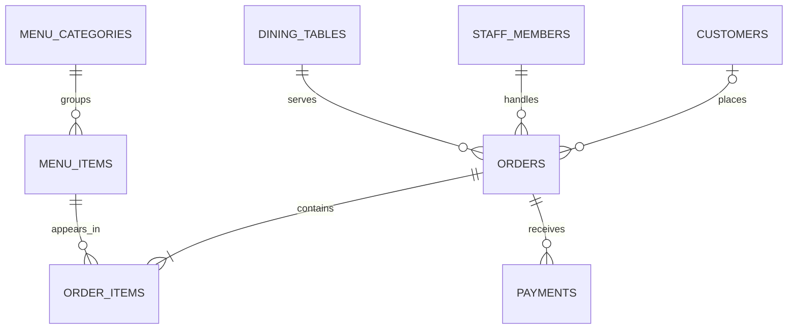

# Restaurant Management Database (MySQL)

A portfolio-ready MySQL project for a small restaurant. It models the menu, staff, tables, customers, orders, order lines, and payments, with example reporting queries.

## What this project demonstrates

- Relational schema design and normalization
- Primary keys, foreign keys, unique constraints, and check constraints
- `DECIMAL` for prices and payment amounts
- Joins, aggregation, grouping, filtering, and views
- A transaction example for saving an order and its line items
- Indexes for common order and menu lookups

## Requirements

- MySQL 8.0.16 or newer (for enforced `CHECK` constraints)
- MySQL Workbench, MySQL Shell, or another MySQL client

## Set it up

From a MySQL client, run the files in this order:

```sql
SOURCE /path/to/restaurant-management-mysql/sql/01_schema.sql;
SOURCE /path/to/restaurant-management-mysql/sql/02_sample_data.sql;
SOURCE /path/to/restaurant-management-mysql/sql/03_reports.sql;
```

Replace `/path/to/` with the folder location on your computer. In MySQL Workbench, open each `.sql` file and run it in order instead.

The schema script creates and selects a database named `restaurant_manager`. It does not delete an existing database.

## Explore the project

After importing the sample data, try these queries in `03_reports.sql`:

- View open kitchen orders
- Calculate order totals
- See daily sales by payment method
- Find popular menu items
- Check table availability
- Review customer order history

The views `v_order_totals` and `v_table_status` provide reusable summaries.

## Data model



`order_items.unit_price` stores the price at the time the order was placed. This preserves historical totals if a menu price changes later.

## Example transaction

The reports file includes a commented transaction pattern: create an order, add its items, and commit them together. If one step fails, roll back so the database does not keep a partial order.

## Suggested GitHub details

**Repository name:** `restaurant-management-mysql`

**Description:** `A MySQL restaurant management database with normalized tables, sample data, views, and reporting queries.`

**Commit title:** `Add MySQL restaurant management database`

**Commit description:** `Create a relational restaurant schema for menu, staff, tables, customers, orders, order items, and payments, with sample data and reporting queries.`
